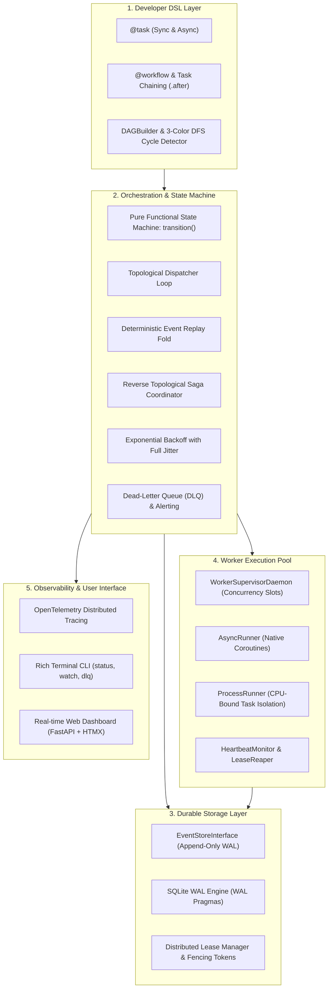

# AegisFlow ⚡🛡️

[](https://github.com/anmolvishvas/AegisFlow/actions/workflows/ci.yml)
[](https://python.org)
[](https://mypy.readthedocs.io/)
[](LICENSE)

> **Resilient Event-Driven DAG Task Engine for Python**  
> *A lightweight, durable workflow orchestrator — bridging the gap between fragile task queues (Celery) and heavy enterprise infrastructure (Temporal/Airflow).*

---

## 🚀 Why AegisFlow?

Building fault-tolerant multi-step data pipelines and business processes in Python often forces teams into an unpleasant dilemma:
- **Task queues like Celery** lack native DAG coordination, event replay, distributed leasing fences, and automated saga rollbacks.
- **Workflow platforms like Temporal or Airflow** require running separate JVM/Go server clusters, complex sidecars, or heavy database migrations for simple services.

**AegisFlow** provides durable, fault-tolerant DAG workflow execution with zero external server dependencies:

| Feature | Celery | Airflow | Temporal | **AegisFlow** |
| :--- | :---: | :---: | :---: | :---: |
| **Zero Infrastructure (Embedded)** | ❌ (Broker req.) | ❌ (Server req.) | ❌ (Cluster req.) | ✅ **Single SQLite WAL file** |
| **Durable Event-Sourced Log** | ❌ | ❌ | ✅ | ✅ **Deterministic WAL** |
| **Topological DAG Scheduling** | ⚠️ (Canvas chains) | ✅ | ✅ | ✅ **Instant cycle detection** |
| **Crash Recovery & Replay** | ❌ | ⚠️ (Task retry) | ✅ | ✅ **Idempotent replay fold** |
| **Saga Rollback Transactions** | ❌ | ❌ | ⚠️ (Manual) | ✅ **Reverse topological order** |
| **Distributed Lease Fencing** | ❌ | ❌ | ✅ | ✅ **Monotonic token fence** |
| **Embedded Live Dashboard** | ❌ (Flower req.) | ✅ | ✅ | ✅ **FastAPI + HTMX + Tailwind** |
| **Built-in Terminal CLI** | ⚠️ | ✅ | ✅ | ✅ **Typer + Rich visualizer** |

---

## 🏛️ Architecture Overview

AegisFlow is architected in 5 decoupled layers:



---

## 📦 Installation

```bash
pip install aegisflow
```

To install development and benchmarking dependencies:

```bash
pip install "aegisflow[dev]"
```

---

## ⚡ Quickstart

### 1. Define and Run a Workflow

```python
import asyncio
from aegisflow import task, workflow, WorkflowOrchestrator, SQLiteStorage


# 1. Define tasks using @task
@task
def extract_data(source_url: str) -> dict:
    return {"raw": [10, 20, 30], "source": source_url}


@task
def transform_data(extract_data: dict) -> list[int]:
    # AegisFlow automatically matches upstream output parameter names!
    return [x * 2 for x in extract_data["raw"]]


@task
def calculate_summary(transform_data: list[int]) -> int:
    return sum(transform_data)


# 2. Chain dependencies
transform_data.after(extract_data)
calculate_summary.after(transform_data)

# 3. Assemble workflow
etl_workflow = workflow("EtlPipeline", tasks=[extract_data, transform_data, calculate_summary])


async def main():
    # 4. Initialize storage and orchestrator
    storage = SQLiteStorage("pipeline.db")
    await storage.initialize()

    orchestrator = WorkflowOrchestrator(
        event_store=storage,
        lease_manager=storage,
    )

    # 5. Execute workflow durably
    state = await orchestrator.run(
        etl_workflow.to_definition(),
        workflow_id="etl_run_001",
        source_url="https://api.example.com/metrics",
    )

    print(f"Status: {state.status}")
    print(f"Result: {state.workflow_output}")  # 120
    print(f"Task Results: {state.task_results}")

    await storage.close()


if __name__ == "__main__":
    asyncio.run(main())
```

---

## 🛡️ Sagas & Automatic Compensation Rollback

For distributed transactions (e.g., e-commerce orders, payments, provisioning), register a compensation rollback function on tasks. If any step fails after retries, AegisFlow rolls back completed steps in **strict reverse topological order**:

```python
@task(compensate=lambda order_id: print(f"Cancelling authorization for {order_id}"))
def authorize_payment(order_id: str, amount: float) -> str:
    return "auth_token_xyz"


@task(compensate=lambda reserve_inventory: print(f"Releasing SKU {reserve_inventory['sku']}"))
def reserve_inventory(order_id: str) -> dict:
    return {"sku": "ITEM-42", "reserved": True}


@task
def issue_invoice(authorize_payment: str) -> None:
    raise RuntimeError("Invoice printer service unavailable!")


# If issue_invoice fails:
# 1. reserve_inventory is compensated FIRST
# 2. authorize_payment is compensated SECOND
# 3. All events are recorded in the WAL
```

---

## 🖥️ Interactive CLI

AegisFlow includes a rich terminal CLI for live workflow inspection, watch mode, and Dead-Letter Queue management:

```bash
# Check version
aegisflow version

# Inspect workflow status and full event history table
aegisflow status etl_run_001 --db pipeline.db

# Live watch workflow execution until completion
aegisflow watch etl_run_001 --db pipeline.db

# Inspect Dead-Letter Queue (DLQ)
aegisflow dlq list --db pipeline.db
```

---

## 📊 Real-Time Web Dashboard

Spin up the embedded FastAPI + HTMX dashboard to visualize workflow runs and event logs in real time:

```python
import uvicorn
from aegisflow import create_dashboard_app

app = create_dashboard_app(database_path="pipeline.db")

if __name__ == "__main__":
    uvicorn.run(app, host="127.0.0.1", port=8000)
```

Visit `http://localhost:8000` to access the dark-slate dashboard interface.

---

## 📈 Performance Benchmarks

Measured on standard commodity hardware:

| Benchmark Metric | Measured Result | Threshold Requirement |
| :--- | :---: | :---: |
| **SQLite WAL Write Throughput** | **~1,000 events/sec** | > 200 events/sec |
| **100-Node DAG Compilation & Sort** | **< 1.0 ms** | < 25 ms |
| **Deterministic Replay Speed** | **~2,000 events/sec** | > 1,000 events/sec |
| **Orchestrator Task Hop Latency** | **~5.7 ms / task hop** | < 40 ms / hop |

---

## 🧪 Testing & Verification Matrix

The repository maintains strict verification standards with 70 comprehensive tests:

- **Unit Tests (`tests/unit/`):** DSL parsing, graph cycle checks, state machine transitions, CLI commands, worker runners.
- **Integration Tests (`tests/integration/`):** SQLite WAL event sourcing, crash recovery replay, resilience retries, sagas, dashboard API.
- **Property-Based Tests (`tests/property/`):** 150+ generated random DAGs and cycles via Hypothesis verifying topological sort and transition invariants.
- **Chaos Recovery Tests (`tests/chaos/`):** Simulated mid-stream worker crashes, lease expirations, reaper cleanups, and monotonic fencing conflict rejection.
- **Benchmarks (`tests/benchmarks/`):** Throughput, replay rate, and task hop latency metrics.

Run tests locally:
```bash
pytest tests/ -v
```

Run static analysis:
```bash
ruff check src tests
ruff format --check src tests
mypy --strict src
```

---

## 📖 Detailed Engineering Documentation

For deep dives into design decisions, state models, and architecture:
- 📋 [Product Requirements Document (PRD)](docs/PRD.md)
- 🏛️ [System Architecture](docs/ARCHITECTURE.md)
- 📜 [Engineering Rules & Guidelines](docs/RULES.md)
- 🎨 [Design & UI Tokens](docs/DESIGN.md)
- ✅ [Implementation Roadmap & Tasks](docs/TASKS.md)
- 🧠 [Project Memory & ADR Log](docs/MEMORY.md)

---

## 📄 License
This project is licensed under the MIT License - see the [LICENSE](LICENSE) file for details.

## 👤 Author
**Anmol Vishvas** ([anmol23vishvas@gmail.com](mailto:anmol23vishvas@gmail.com))
