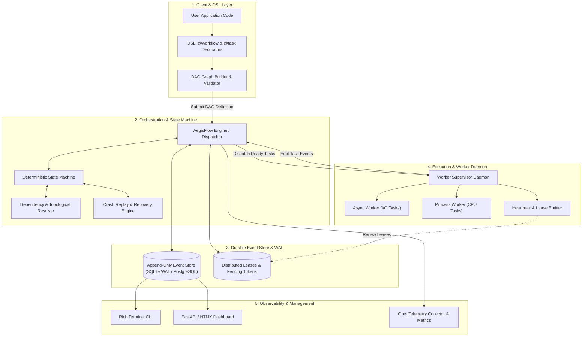

# System Architecture
## AegisFlow: Resilient Event-Driven DAG Task Engine

---

### 1. High-Level Architecture Overview

AegisFlow follows an **Event-Sourced Orchestrator-Worker** architecture. State is never mutated in-place; all transitions are appended as immutable events into an append-only Write-Ahead Log (WAL). The system is partitioned into five distinct layers:



---

### 2. Core Architectural Subsystems

#### 2.1 DSL & Graph Builder
- **Responsibility:** Parses user functions, validates DAG properties at definition time.
- **Cycle Detection:** Executes Kahn's algorithm or depth-first search (DFS) with three-color marking (`White`, `Gray`, `Black`) to reject circular dependencies immediately with a descriptive `CycleDetectedError`.
- **Serialization:** Generates an immutable `WorkflowDefinition` comprising `TaskDefinition` nodes, upstream dependencies, retry configurations, timeouts, and compensation hooks.

#### 2.2 Event Sourcing & Write-Ahead Log (WAL)
- **Responsibility:** Guarantees durability and single source of truth.
- **Event Types:**
  - `WorkflowInitiated`, `WorkflowRunning`, `WorkflowCompleted`, `WorkflowFailed`, `WorkflowCompensating`
  - `TaskScheduled`, `TaskLeased`, `TaskStarted`, `TaskHeartbeat`, `TaskCompleted`, `TaskFailed`, `TaskRetried`, `TaskCompensated`
- **Storage Backends:**
  - **Embedded Mode (Default):** SQLite configured in `PRAGMA journal_mode=WAL; PRAGMA synchronous=NORMAL;` with transaction locks.
  - **Distributed Mode:** PostgreSQL using `SELECT ... FOR UPDATE SKIP LOCKED` for task queues and transaction-safe event journals.

#### 2.3 Orchestrator & State Machine
- **State Machine:** Pure, deterministic transition functions: `(CurrentState, IncomingEvent) -> (NewState, [SideEffects])`.
- **Topological Dispatcher:** Whenever a task emits `TaskCompleted`, the dispatcher evaluates downstream dependents. If all parent tasks have completed successfully, the downstream task moves to `READY` and is queued for execution.

#### 2.4 Worker Daemon & Distributed Lease Manager
- **Lease Mechanism:** When a worker claims a task, it acquires a lease for `N` seconds with a monotonically increasing **fencing token**.
- **Heartbeats:** The worker runs a background loop renewing the lease every `N / 3` seconds.
- **Zombie Worker Protection:** If a worker hangs, runs out of memory, or disconnects, the lease expires. A reaper process reassigns the task. Any late-arriving results from the zombie worker are rejected via the fencing token.
- **Execution Engines:**
  - `AsyncExecutor`: For high-concurrency, network/IO-bound workflows (`asyncio`).
  - `ProcessPoolExecutor`: For CPU-bound workflows bypassing the Python GIL.

#### 2.5 Crash Recovery & Replay Engine
- If an AegisFlow process terminates unexpectedly (e.g., `SIGKILL`, system reboot):
  1. The engine scans the event store for active, incomplete workflows.
  2. For each workflow, it reconstructs the DAG and replays the event stream.
  3. Tasks with recorded `TaskCompleted` events are skipped; their historical outputs are injected into downstream dependents.
  4. The engine resumes execution starting from the exact tasks that were `SCHEDULED`, `RUNNING` (lease expired), or `RETRYING`.

---

### 3. Technology Stack

| Component | Technology | Rationale |
| :--- | :--- | :--- |
| **Language** | Python 3.11+ | Utilizes task groups (`asyncio.TaskGroup`), exception groups, enhanced tracebacks, and fast runtime. |
| **Type Checking** | `mypy --strict`, `pyright` | Zero tolerance for untyped code; ensures library consumer type safety (`py.typed`). |
| **Data Models & SerDe** | `msgspec` / `pydantic v2` | High-performance serialization (JSON/MessagePack) with strict schema validation. |
| **Embedded Storage** | `aiosqlite` / `sqlite3` (WAL mode) | Zero external dependency setup for local execution, tests, and single-node production. |
| **Distributed Storage** | `asyncpg` + PostgreSQL | Battle-tested relational consistency and row-level locking (`SKIP LOCKED`) for multi-worker scaling. |
| **Terminal UI / CLI** | `rich` + `typer` | Beautiful progress bars, DAG renderers, and interactive terminal dashboard. |
| **Web Dashboard** | `fastapi` + `htmx` + `tailwind` | Ultra-lightweight, zero-build-step server-rendered real-time dashboard via Server-Sent Events (SSE). |
| **Observability** | `opentelemetry-api`, `prometheus-client` | Vendor-neutral distributed tracing and metrics emission. |
| **Testing & Quality** | `pytest`, `pytest-asyncio`, `hypothesis` | Property-based testing for DAG topology and crash-chaos simulation. |

---

### 4. Project Folder Structure

```
resilient-dag-engine/
│
├── .github/
│   └── workflows/
│       ├── ci.yml                 # Matrix test (Python 3.11, 3.12, 3.13), lint, type-check
│       └── release.yml            # Automated PyPI packaging & release
│
├── docs/
│   ├── architecture/              # Deep-dive specs and ADRs
│   ├── tutorials/                 # Getting started and saga guides
│   └── index.md                   # MkDocs documentation entry
│
├── src/
│   └── aegisflow/
│       ├── __init__.py            # Public API exports (@workflow, @task, Engine, Client)
│       ├── py.typed               # PEP 561 type marker
│       │
│       ├── core/                  # Core abstractions and domain models
│       │   ├── __init__.py
│       │   ├── events.py          # Immutable event definitions (Event sourcing)
│       │   ├── states.py          # Workflow & Task lifecycle state enums
│       │   ├── models.py          # TaskDefinition, WorkflowDefinition, ExecutionContext
│       │   └── exceptions.py      # Domain-specific hierarchy of exceptions
│       │
│       ├── dsl/                   # User-facing decorators and syntax
│       │   ├── __init__.py
│       │   ├── task.py            # @task decorator & options
│       │   ├── workflow.py        # @workflow decorator & runner
│       │   └── graph.py           # DAG builder, topological sort, cycle detection
│       │
│       ├── storage/               # Persistence layer (Event Store & Leases)
│       │   ├── __init__.py
│       │   ├── base.py            # Abstract Base Classes (EventStoreInterface, LeaseManagerInterface)
│       │   ├── sqlite.py          # SQLite WAL implementation (Embedded mode)
│       │   └── postgres.py        # PostgreSQL implementation (Distributed mode)
│       │
│       ├── engine/                # Engine orchestration & execution
│       │   ├── __init__.py
│       │   ├── orchestrator.py    # Main event loop & task dispatcher
│       │   ├── state_machine.py   # Pure functional state transition engine
│       │   ├── lease.py           # Distributed lease manager & heartbeat monitor
│       │   ├── replay.py          # Event-log replay & crash recovery engine
│       │   └── saga.py            # Compensation execution engine
│       │
│       ├── workers/               # Worker pool & execution runtimes
│       │   ├── __init__.py
│       │   ├── daemon.py          # Worker process supervisor
│       │   ├── async_runner.py    # AsyncIO task executor
│       │   └── process_runner.py  # Multiprocessing CPU executor
│       │
│       ├── observability/         # Monitoring, logging, metrics
│       │   ├── __init__.py
│       │   ├── telemetry.py       # OpenTelemetry spans & trace propagation
│       │   └── metrics.py         # Prometheus metrics collectors
│       │
│       ├── cli/                   # Developer CLI
│       │   ├── __init__.py
│       │   └── main.py            # Typer + Rich terminal commands
│       │
│       └── dashboard/             # Real-time web UI
│           ├── __init__.py
│           ├── app.py             # FastAPI app serving SSE & REST
│           ├── templates/         # Jinja2 / HTMX views
│           └── static/            # CSS & icons
│
├── tests/
│   ├── unit/                      # Fast in-memory unit tests
│   │   ├── test_graph.py          # Cycle detection, dependency resolution
│   │   ├── test_state_machine.py  # Pure state transitions
│   │   └── test_dsl.py            # Decorator contracts
│   ├── integration/               # Integration tests with SQLite / Postgres
│   │   ├── test_sqlite_store.py
│   │   ├── test_recovery.py       # Crash & resume tests
│   │   └── test_saga.py           # Compensation rollbacks
│   ├── chaos/                     # Chaos engineering tests (SIGKILL workers)
│   │   └── test_worker_crash.py
│   └── property/                  # Hypothesis property-based tests
│       └── test_dag_properties.py
│
├── benchmarks/
│   ├── bench_dispatch.py          # Latency & throughput benchmarks
│   └── bench_wal_writes.py        # SQLite WAL write throughput
│
├── examples/
│   ├── 01_simple_pipeline.py      # Basic fan-out / fan-in
│   ├── 02_payment_saga.py         # Rollback upon payment failure
│   └── 03_llm_agent_pipeline.py   # Multi-step AI tool pipeline with resume
│
├── pyproject.toml                 # Build config (Hatchling/Flit), dependencies, Ruff & Mypy settings
├── README.md                      # Comprehensive user guide & architecture badges
├── ARCHITECTURE.md                # System Architecture specification
├── PRD.md                         # Product Requirements Document
├── RULES.md                       # Development & AI Coding Standards
├── DESIGN.md                      # UI/UX & Design Tokens specification
├── TASKS.md                       # Project roadmap & implementation task list
└── MEMORY.md                      # Live project state & engineering journal
```
